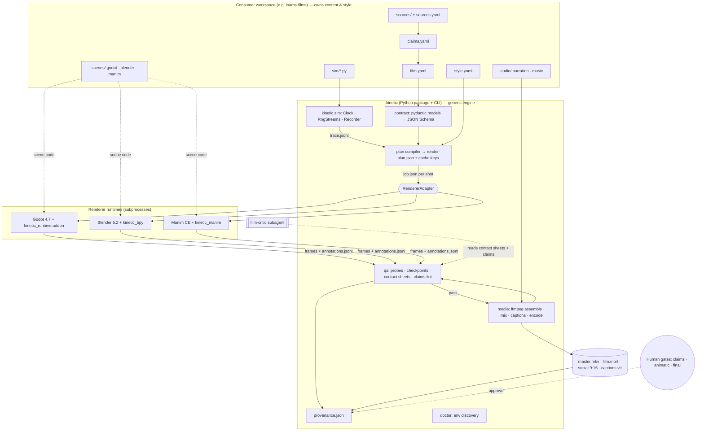

# Kinetic — Architecture Proposal (planning only, nothing implemented)

**Organization:** ostrium-labs · **Repo:** `kinetic` (name is free in the org) · **Tagline:** Programmable cinematography for engineering.
**Status:** Revision 3 (M0 measured, see `m0-report.md`). Revision 2 was conditionally approved (architecture review, 2026-10-30). The six review corrections are applied below. v0.1 freezes on the measured M0 results (`m0-report.md`). No repository or Kinetic code exists yet.

**Revision 2 changes:** (1) The pilot claims are corrected: the 80 PUT/s figure conflicts with the 8 MiB cap, and "losing every node loses no data" is scoped to the retrieval engine (§13). (2) A typed trace contract is added, with ticks, spans, ordering and interpolation semantics (§7). (3) A cinematic look-development gate is added to M2 (§14). (4) The Blender runtime is now GPL, with a JSON-only boundary (§3, §6). (5) The import package is now `ostrium_kinetic` (§2). (6) Godot output resolution is pinned via viewport stretch and verified at 1080p in M0; uv is fixed by PATH order, not by uninstalling (§8, §10).

Earlier status: no repository, code, installs or renders had been made. Everything about Godot/Blender/Manim behaviour below is either *verified on this machine* (marked ✔), *documented upstream* (marked 📄), or *assumed until the M0 spike* (marked ⚠).

## Context

Ostrium Labs wants a framework for making technical films where **the simulation drives the animation**: what moves on screen comes from a modelled, traced or measured mechanism, and each visual says what kind of evidence it rests on. The first consumer is the Loams blog (62 posts as of 2026-10-30, not 61). The engine must stay independent of Loams and be usable later by Ostrium research, `ferite`, and educational/interactive work. This document is the full design and the implementation sequence, ready for review before any code is written.

---

## 1. Executive recommendation

1. **Build Kinetic as a small Python 3.12 package and CLI (`kinetic`) managed with uv.** It orchestrates three renderers as subprocesses and owns the contract, simulation core, timeline, media assembly, QA and provenance. Python is the right choice because Blender (`bpy`) and Manim are Python-native, uv gives reproducible locks on Windows, and the orchestration work is I/O and subprocess bound. Rust was considered, since it is the org's main language, but it would add a compile loop without removing Python. TypeScript was rejected: the website being a consumer is no reason to choose it.
2. **The central abstraction is the Trace, not a universal scene DSL.** A simulation writes a deterministic, typed event trace (`trace.jsonl`). Every renderer *samples* that trace at integer frame times. Renderers share the trace, the timeline, the style tokens, the evidence labels and the output profile. They do **not** share scene geometry or camera descriptions. Scene implementations are renderer-native code (GDScript, bpy, Manim) behind one small job interface.
3. **Renderer roles:** Godot is the workhorse for trace-driven 3D mechanism shots. Manim handles arithmetic, charts, equations and algorithm-on-data shots. Blender is limited to a few hero and establishing shots per film. FFmpeg does all assembly and encoding. Kdenlive is optional human finishing and is never in the automated path.
4. **Drop cables.gl.** It duplicates Godot and the web player. Kokoro narration is **optional and deferred to M5** as a scratch/animatic voice; human narration stays the default for flagship films. LaTeX is optional: equations go through Manim `MathTex` when LaTeX exists, or through Typst→SVG otherwise.
5. **Pilot film:** *"Your bucket is the database"* (Loams, Opinions #2). It exercises every renderer, every evidence class (list prices, a measured spike, computed arithmetic, design targets, simulation) and a real failure-and-recovery mechanism. Pilots #2 and #3 are *Hybrid retrieval fusion* (computation-driven Manim) and *The MySQL wire protocol* (packet-capture-driven trace).
6. **Reorder the milestones.** Minimal assembly and QA move into the Godot smoke milestone, because nothing can be verified without them. A pilot **animatic** comes before the Blender and Manim adapters, so the film decides which adapter features get built. "Reusable components" are extracted only after the second film.
7. **This laptop can do it, within limits.** It has an i5-1135G7 (4C/8T), 15.7 GB RAM, Iris Xe with no discrete GPU, and 208 GB free. Preview at 720p30 is fine. 1080p production works for Godot and Manim. Blender runs on EEVEE only (M0: ~9 s/frame at 1080p/64 spp), budgeted to ≤ 60 s of footage per film, ~4.5 h overnight. Cycles is used for stills only.

---

## 2. Repository name and positioning

- `ostrium-labs/kinetic` **does not exist** (checked with `gh repo view`: "Could not resolve"). The org has 45 public repos and uses Apache-2.0 widely (`loams-identity`, `loams-marketplace`, `loams-data-api`).
- **Name collisions:** `ariya/kinetic` (808★), KineticJS (4k★), and Seagate's "Kinetic" open storage project, which is awkward for a storage-heavy first consumer. **PyPI `kinetic` is taken** (HTTP 200). `ostrium-kinetic` is free.
  - **Decision (rev 2):** repo `ostrium-labs/kinetic`, PyPI distribution `ostrium-kinetic`, **import package `ostrium_kinetic`**, CLI command `kinetic`. This avoids the clash with the unrelated PyPI `kinetic` now, rather than renaming public imports later.
- **Positioning (README first line):** "Kinetic turns simulations, traces and measurements into reproducible technical films. Every moving thing on screen is either data, or labelled as not data."
- **Naming note:** the brief says "Ferrite", but the org repo is **`ferite`**. Confirm the spelling before any docs reference it.
- **Skills location:** Kinetic's skills should be **project-local** in `kinetic/.claude/`, because they depend on the CLI. Once stable, they can be published to a shared organization skills collection, never sourced from one (see §16).

---

## 3. Technology decisions and tradeoffs

### Verified local state (read-only probes, 2026-10-30)

| Tool | Reported | Found ✔ | Issue |
|---|---|---|---|
| Godot | 4.7.2 | `…\WinGet\Packages\GodotEngine…\Godot_v4.7.2-stable_win64_console.exe` → `4.7.2.stable.official` | **Not on PATH** as `godot`. Use the `_console.exe` variant so stdout is captured. |
| Blender | 5.2.3 | `C:\Program Files\Blender Foundation\Blender 5.2\blender.exe` → `5.2.3 LTS` | Not on PATH |
| FFmpeg | Gyan | `ffmpeg 9.0.2-full_build` on PATH | GPL build. Encoders listed: libx264/x265, libsvtav1, ffv1, prores_ks, h264/hevc/av1_qsv, nvenc/amf (nvenc and amf are unusable without NVIDIA/AMD hardware) |
| Kdenlive | 26.08.2 | `…\Programs\Kdenlive\bin\kdenlive.exe`, `melt.exe` | Not on PATH |
| uv | 0.13.6 | **`uv` on PATH resolves to 0.11.31** (`Python312\Scripts\uv.exe`, pip-installed). The winget 0.13.6 is shadowed. | **PATH-order bug.** Fix: `py -m pip uninstall uv` (owner action) |
| Python | 3.12.13 | System `python` = **3.12.9**. uv-managed 3.12.13 exists. | Pin `.python-version` = 3.12 and let uv pick the managed interpreter |
| Manim | 0.22.1 | `~\.local\bin\manim.exe` (uv tool) → v0.22.1 | A global tool is not importable from Kinetic's venv. Make it a locked project dependency. |
| LaTeX/dvisvgm | – | absent | Non-blocking by design |
| gh | – | 2.98.0, logged in, scopes `repo, read:org, workflow` | – |
| GPU | – | Intel Iris Xe (driver 32.0.101.7088), no NVIDIA/AMD | QSV H.264/HEVC encode is likely. ⚠ AV1 QSV *encode* is likely unsupported on Tiger Lake, despite FFmpeg listing `av1_qsv` |
| CPU/RAM/Disk | – | i5-1135G7 4C/8T, 15.7 GB, C: 208 GB free | Constrains Blender and frame-sequence storage |

### Component decisions

| Component | Decision | Responsibilities | Automation surface | Headless | I/O | License (commercial) | Main failure modes / mitigations | Alternatives rejected |
|---|---|---|---|---|---|---|---|---|
| **Python + uv** | **Core** | Contract, sim core, CLI, adapters, media, QA, provenance | Full | Yes | YAML/JSON in, everything out | Python PSF; uv MIT/Apache | PATH shadowing (above), Windows path quoting → always pass `list[str]` to `subprocess`, never `shell=True` | Rust (compile loop, still needs Python), TS/Node (no bpy/Manim) |
| **Godot 4.7** | **Primary mechanism renderer** | Trace-driven 3D/2D scenes, cameras, shaders, particles where they encode data | CLI `--path … --write-movie out/frame.png --fixed-fps N --resolution WxH --quit-after N -- <user args>` 📄 | **No.** 📄 `--headless` disables rendering, so Movie Maker needs a real display and GPU context. On Windows a window appears. On Linux CI it needs `xvfb-run` + Mesa llvmpipe with `--rendering-method gl_compatibility` ⚠ | Job JSON + trace in, PNG sequence out (or MJPEG AVI) | MIT (engine), fonts/assets per their own license | Window focus/minimise stalls ⚠, frame-0 and off-by-one semantics of `--quit-after` ⚠, Forward+ on Iris Xe performance ⚠ → M0 spike decides between `forward_plus` and `gl_compatibility` | Unity/Unreal (license, weight), three.js offline capture (fragile frame capture) |
| **Blender 5.2** | **Hero shots only** | Establishing shots, procedural geometry, lighting, materials | `blender -b --factory-startup -P kinetic_bpy/run.py -- --job job.json` | **Yes** (`-b`). EEVEE needs a GPU context. On Windows Iris Xe that should work ⚠. Linux EEVEE headless ⚠. Cycles CPU works anywhere but is slow. | Job JSON in, PNG/EXR out | GPL-2.0-or-later. **Rendered output is unrestricted; films are not GPL.** Blender's licensing FAQ says distributed scripts using the `bpy` API must comply with the GPL. Therefore (rev 2) `renderers/blender/` is licensed **GPL-2.0-or-later** with its own LICENSE file. It **never imports `ostrium_kinetic`** and talks to the core only through job/trace JSON files and a subprocess, so the Apache-2.0 core stays a separate work. The boundary is documented in `THIRD_PARTY.md` and `docs/licensing.md`. | Long render times on Iris Xe, add-on drift, version-specific API breaks → pin to 5.2 LTS, `--factory-startup` | Godot alone (weaker offline lighting), Cycles for motion (too slow here) |
| **Manim CE 0.22** | **Math/chart renderer** | Arithmetic, plots, ranking/algorithm steps over real data, equations | Python API in-process (`tempconfig` + `Scene.render()`) inside a **separate subprocess** for isolation | Yes (Cairo, CPU) | Job JSON + data in, PNG frames via `--format=png-sequence --disable_caching` (M0: `--format=png` writes only the last frame, and a frozen `wait()` emits one frame, so waits use `frozen_frame=False`) | MIT | LaTeX missing → `MathTex` unavailable. Fallback: `Text`/`MarkupText` (Pango), or Typst→SVG → `SVGMobject` | Motion Canvas (TS), ManimGL (less stable API) |
| **FFmpeg 9** | **Core media** | Mezzanine encode, concat, audio mix, loudness, captions burn-in (social), probes, QA filters | CLI + `ffprobe -of json` | Yes | Any | LGPL/GPL depending on build. Gyan *full* is **GPLv3**, which is fine when invoked as a separate program and **not redistributed**. H.264/HEVC **patent pools**: royalty-free for free internet distribution of content, but flag for paid/broadcast use. AV1 and FFV1 are royalty-free. | Wrong RGB→YUV matrix (defaults to BT.601) → use `scale=out_color_matrix=bt709:out_range=tv,format=yuv420p,setparams=colorspace=bt709:color_primaries=bt709:color_trc=bt709:range=tv` plus the output tag flags (M0: without `setparams`, primaries/trc stay `unknown`); QA asserts all four tags | PyAV (binds same libs, harder Windows wheels for exotic codecs), MoviePy (slow, lossy defaults) |
| **Kdenlive / MLT** | **Optional, out of automated path** | Human finishing, colour and sound polish | `.kdenlive` = MLT XML; `melt` CLI | melt yes | MLT XML | GPL (app) / LGPL (MLT) | Edits don't round-trip back into Kinetic → master is stamped `hand_finished: true` in provenance | — |
| **cables.gl** | **Rejected** | — | Browser patch editor | n/a | — | MIT (open-sourced 2024) | Would be a fourth scene authoring system with no trace contract | Companion is a trace-JSON web player (M7) |
| **Kokoro-82M** | **Optional, M5** | Scratch/animatic narration, possibly final with disclosure | Python package | Yes, CPU | text → 24 kHz WAV | Weights Apache-2.0 ⚠ verify at adoption; G2P (`misaki`) falls back to **espeak-ng (GPL-3.0)**, invoked as a separate library/process. Fine for use, flag for redistribution. | CPU speed on i5 ⚠, pronunciation of jargon ("TiKV", "HNSW") → per-film pronunciation lexicon | Piper (MIT engine, voice licenses vary), cloud TTS (excluded by brief) |
| **Typst** | **Optional equation path** | Equations to SVG without LaTeX | `typst compile x.typ x.svg` | Yes | .typ → SVG | Apache-2.0 | Not installed; installed only when an equation shot needs it | MiKTeX (optional, free; mixed LPPL/GPL, fine for commercial) |

**Libraries (Python, all permissive):** pydantic v2 (MIT), typer (MIT), ruamel.yaml (MIT; keeps comments), numpy (BSD), structlog (MIT/Apache), pytest + hypothesis (MIT/MPL-2.0), scikit-image (BSD, SSIM), pillow (MIT-CMU). No SimPy: a 200-line deterministic event loop is easier to reason about and to make byte-reproducible.

---

## 4. System architecture

The proposed pipeline is right in spirit, but it is missing two boundaries: a **claims ledger** that sits *beside* the narrative rather than inside it, and a **compiled render plan** between the human-authored spec and the renderers. The improved pipeline is below. The left column is authored by humans or Claude, the right column is machine-produced and cacheable.

| Stage | Owner | Artefact | Boundary rule |
|---|---|---|---|
| 1 Source intake | Consumer workspace | `sources/*.md` + `sources.yaml` (URL, retrieved_at, sha256) | Kinetic never fetches the Loams site at render time |
| 2 Evidence & analysis | `/film-director` + human | `claims.yaml` (claim ledger) | Every number or assertion on screen references a claim id |
| 3 Film spec | `/film-director` | `film.yaml`: thesis, arc, sequences, shots (intent only) | No renderer details |
| 4 Shot design | `/scene-architect` | Shot entries gain `renderer`, `scene`, `sim`, `timemap`, `checkpoints`, `framings` | Declarative only |
| 5 Domain model & simulation | `/scene-architect` (sim code) | `sim/*.py` → `trace.jsonl` + `trace.meta.json` | Pure, seeded, no wall clock, no rendering imports |
| 6 Compile | `kinetic plan` | `render-plan.json` (normalised, hashed, per-shot cache keys) | Only the CLI writes it |
| 7 Render | Adapters → Godot / Blender / Manim | `cache/shots/<key>/frames/*.png` + `annotations.jsonl` + `shot.json` | Renderers read the job and trace and write frames. They never compute domain logic. |
| 8 Media | `kinetic assemble` | Per-shot FFV1 mezzanines → master, delivery, social | FFmpeg only |
| 9 QA | `kinetic qa` + `film-critic` agent | `qa/report.json`, contact sheets, checkpoint stills | Exit 0 from a renderer counts for nothing until QA passes |
| 10 Release | Human | Approval recorded in `provenance.json` | Human signs off accuracy and craft |

**Ownership boundaries:**
- **Narrative** (film.yaml prose, claims) never contains numbers that are not claim references.
- **Domain modelling** (sim) never knows about pixels or cameras.
- **Visual representation** (scene code) never invents state. It reads `state_at(frame)` from the trace. Any motion not derived from the trace must be tagged `illustrative`, and it may not encode quantities.
- **Rendering** is the adapter's job: process management, paths, flags.
- **Media processing** is FFmpeg's job: assembly, mix and encode.
- **Human review** happens at three gates: claims approved, animatic approved, final approved.

**Evidence classes** (a closed enum; displayed on screen when they are not `trace`/`measured`):

| Class | Meaning | Example (pilot) | On-screen badge |
|---|---|---|---|
| `trace` | Recorded from a real system run | (pilot #3: MySQL pcap) | none, source in credits |
| `measured` | Benchmark result with methodology | "22 ms p50 / 148 ms p99, Postgres bucket-WAL spike (D234)" | `MEASURED · spike` |
| `sourced` | External published figure | S3 $0.023/GB-mo, AWS list price, 2026-09-22 | `LIST PRICE · us-east-1` |
| `computed` | Deterministic arithmetic from cited inputs | 3 × $0.08 = $0.24 | none (inputs shown) |
| `simulated` | Seeded model of the mechanism | Read fall-through H3→H0→bucket under node loss | `SIMULATED · model, not Loams` |
| `hypothetical` | Design target or scenario not built | "express WAL 20–50 ms p99 target" | `DESIGN TARGET · not measured` |
| `illustrative` | No data semantics | Establishing shot of strata | none, but lint forbids numbers or labels bound to it |

The `sourced` class is added to the brief's list because published vendor figures differ from Ostrium's own measurements.

---

## 5. Architecture diagram



---

## 6. Proposed repository tree (`ostrium-labs/kinetic`)

```
kinetic/
├─ pyproject.toml            # dist "ostrium-kinetic", requires-python ">=3.12,<3.13"
├─ uv.lock                   # committed
├─ .python-version           # 3.12
├─ kinetic.toml.example      # tool paths, cache dir, hardware profile overrides
├─ LICENSE (Apache-2.0) · NOTICE · THIRD_PARTY.md · README.md · CLAUDE.md
├─ src/ostrium_kinetic/       # import name; CLI entry point "kinetic"
│  ├─ cli/                   # typer app: doctor, validate, sim, plan, render, assemble, qa, provenance, clean
│  ├─ contract/              # pydantic models: film, shot, claim, evidence, timemap, style, profile, job
│  ├─ schema/                # generated JSON Schema (committed; CI fails on drift)
│  ├─ sim/                   # clock.py, rng.py (SeedSequence streams), recorder.py, trace.py (read/fold/state_at)
│  ├─ timeline/              # Fraction fps, frame<->time, timemap (sim time -> film time)
│  ├─ plan/                  # compiler, hashing, cache keys, dependency graph
│  ├─ adapters/              # base.py (Protocol), godot.py, blender.py, manim.py, process.py (timeouts, logs)
│  ├─ media/                 # ffmpeg.py (arg builders), mezzanine.py, assemble.py, audio.py, captions.py, profiles.py
│  ├─ qa/                    # probes.py, frames.py (gaps/black/freeze), checkpoints.py, contact_sheet.py, ssim.py, claims_lint.py
│  ├─ env/                   # discovery.py (PATH, winget, Program Files, env overrides), doctor checks, hardware.py
│  ├─ provenance/            # manifest builder
│  └─ log.py                 # structlog JSON lines → .kinetic/logs/
├─ renderers/
│  ├─ godot/                 # a Godot project
│  │  ├─ project.godot
│  │  ├─ addons/kinetic_runtime/   # job_loader.gd, frame_clock.gd (frame index -> time; no delta accumulation),
│  │  │                             # trace_player.gd (state_at), annotator.gd (screen-space bboxes), style.gd
│  │  └─ library/            # reusable nodes: Node, Link, Packet, Label3D conventions (grown, not designed upfront)
│  ├─ blender/               # LICENSE = GPL-2.0-or-later (bpy code); never imports ostrium_kinetic
│  │  └─ kinetic_bpy/        # run.py (job entry), trace reader (own copy, JSON only), scene utils; stdlib + bpy only
│  └─ manim/kinetic_manim/   # KineticScene base (reads job, style tokens, trace), label/badge helpers
├─ examples/
│  └─ smoke-failover/        # film.yaml, sim/failover.py, scenes/godot/failover.tscn (+ blender variant in M4)
├─ tests/
│  ├─ unit/                  # contract, timeline, sim determinism, plan hashing, ffmpeg arg builders
│  ├─ integration/           # @pytest.mark.renderer("godot"|"blender"|"manim"|"ffmpeg") — skipped if tool absent
│  └─ golden/                # tiny (<=256 px wide) reference PNGs + expected annotations; < 2 MB total
├─ docs/
│  ├─ architecture.md · contract.md · evidence-policy.md · visual-language.md · windows-setup.md
│  └─ adr/                   # 0001-python-orchestrator, 0002-trace-not-dsl, 0003-frame-sequences, …
├─ .claude/
│  ├─ skills/  film-director/ scene-architect/ godot-scene/ blender-scene/ manim-scene/ render-and-verify/
│  ├─ agents/  film-critic.md
│  └─ settings.json          # allowlist: uv run kinetic *, ffprobe, git status/diff
└─ .github/workflows/
   ├─ ci.yml                 # ubuntu + windows: ruff, pyright, unit tests, schema drift, manim smoke (CPU)
   └─ render-smoke.yml       # workflow_dispatch; Windows runner; Godot via cached zip; ⚠ may need self-hosted GPU runner
```

**Consumer workspace** (recommended separate repo `ostrium-labs/loams-films`, private): `kinetic.toml`, `style/loams.yaml`, `films/your-bucket-is-the-database/{film.yaml, claims.yaml, sources/, sim/, scenes/{godot,blender,manim}/, audio/}`. It pins Kinetic as a uv git dependency on a tag. The consumer's `scenes/godot/` is mounted into Kinetic's Godot project at render time as a `res://workspace/` overlay. Kinetic copies or junctions it into a per-run cache project, so Kinetic's repo is never modified.

**Generated artefacts:** everything under `.kinetic/` (cache, frames, mezzanines, logs) and `out/` is gitignored. Finished films go to a release store, which is owner decision §16 (GitHub Releases for small ones, object storage otherwise). Never Git LFS for frames.

---

## 7. Scene contract design

**Decision:** **Pydantic v2 models in `ostrium_kinetic.contract` are the single source of truth.** JSON Schema is *generated* from them and committed, for editor validation and for GDScript-side sanity checks. Humans and Claude author **YAML**, because it allows comments and is readable in diffs. The compiler emits **canonical JSON** (sorted keys, normalised numbers) for hashing. Rejected options:
- Hand-written JSON Schema as the master: duplicates the type logic.
- Pure Python scene files: these are not data, cannot be diffed as data, and make cache keys hard to compute.
- A custom DSL: cannot express real simulations.

Every document carries `kinetic: "0.1"`. Migrations are explicit functions `migrate_0_1_to_0_2`.

### What is declarative vs code

| Declarative (YAML, validated) | Executable code (behind interfaces) |
|---|---|
| Identity, sources, claims, assumptions/limitations | Simulation models (`sim/*.py`, implements `Simulation`) |
| Sequences, shots, durations, renderer choice, timemaps | Scene implementations (`.tscn`+GDScript, bpy module, Manim `KineticScene`) |
| Seeds, sim parameters | Custom shaders and geometry generators |
| Style tokens (type, colour semantics, motion curves) | Camera *paths* (renderer-native; spec carries only intent + named framing) |
| Checkpoints (assertions about state at time t) | Data-to-visual mappings |
| Narration text and segments, subtitle text, audio refs | |
| Output profiles, framings (16:9 / 9:16) | |

### Example (abridged `film.yaml`)

```yaml
kinetic: "0.1"
id: loams.bucket-is-the-database
title: "Your bucket is the database"
sources:
  - id: post
    url: https://loams.dev/blog/your-bucket-is-the-database
    retrieved: 2026-10-30
    sha256: "…"
style: ../../style/loams.yaml
profiles: [preview, production, social]
assumptions:
  - id: A1
    text: "Read-path simulation uses illustrative latencies from design-04 targets, not Loams measurements."
sequences:
  - id: S4
    title: "Losing a node loses a cache"
    shots:
      - id: S4.2
        intent: "Node B dies mid-query; reads fall through to the bucket; results identical; latency rises then recovers."
        renderer: godot
        scene: workspace/scenes/godot/read_path.tscn
        sim: { module: sim.read_path, params: { nodes: 3, kill_node_at_s: 4.0, warm_rate: 0.2 }, seed: 1017 }
        evidence: simulated
        claims: [C12, C13]            # "identical results with/without hot tiers", "cold 0.5–1 s target"
        duration: { frames: 240 }     # at film fps
        timemap: { mode: linear, sim_start_s: 0, sim_end_s: 12, label: "time compressed 1.5×" }
        framings:
          "16:9": { camera: wide_left }
          "9:16": { camera: tall_stack }   # deliberate reframing, not a crop
        checkpoints:
          - at_frame: 130
            expect: { "node.B.state": "dead", "query.q7.served_from": "bucket" }
          - at_frame: 230
            expect: { "query.q7.result_hash": { equals_checkpoint_of: "S4.1" } }
        narration: N4.2
narration:
  - id: N4.2
    text: "Node B is gone. Its cache went with it. The query doesn't care: the bucket still has every byte."
```

### Core interfaces (sketches, not implementation)

```python
class Simulation(Protocol):
    def run(self, params: Mapping[str, Any], rng: RngStreams, rec: Recorder) -> None: ...
# Recorder.emit(tick: int, type: str, entity: str, **fields); Recorder.begin_span(...) -> span_id; Recorder.end_span(span_id, outcome)
# Trace.state_at(tick) -> immutable dict (step semantics); Trace.spans_active(tick) -> [(span, progress)] (interp semantics)

class RendererAdapter(Protocol):
    name: Literal["godot", "blender", "manim"]
    def probe(self, env: Env) -> ToolStatus
    def render(self, job: ShotJob, out: Path, log: Logger) -> ShotResult   # never raises on renderer failure; returns status

class ShotJob(BaseModel):     # serialised to job.json, read by renderer-side runtime
    shot_id: str; scene: str; fps: Fraction; width: int; height: int
    frame_start: int; frame_count: int; framing: str
    trace_path: Path | None; timemap: TimeMap; params: dict; seed: int
    style: StyleTokens; quality: QualityTier; annotate: bool
```

### Trace contract v0.1 (rev 2)

The rule is that **the simulation determines what happened and when, and the renderer determines geometry and how that state is shown.** `state_at(t)` alone cannot define continuous motion, so the trace has four parts:

1. **Time is integer ticks.** Every trace declares `tick_rate` as a rational number (e.g. `1/1000000` s per tick for µs). Event times are `int` ticks; floats never enter the trace. Seconds are a presentation format only. Film frame *f* maps to sim tick via the shot's `timemap`, using exact `Fraction` arithmetic with floor rounding.
2. **Stable entity IDs.** These are `"<type>:<name>"` strings (e.g. `node:B`, `packet:7`), introduced by an `entity.created` event and ended by `entity.destroyed`. They are never reused within a trace. Each entity type has a registered schema: its state fields and their types.
3. **Total, deterministic ordering.** The order key is `(tick, seq)`, where `seq` is the recorder's emission counter. Simultaneous events are ordered by `seq`, never by dict or hash order. The JSONL is written in order key order with canonical JSON.
4. **Typed lifecycle events and spans with interpolation semantics.** Events are either *instant* (`state.set`, `entity.created/destroyed`, `fault.injected`, `timeout.fired`) or *span* boundaries (`span.begin` / `span.end` with a `span_id`). After the sim run, the recorder **resolves spans** into `spans.jsonl`: `{span_id, entity, kind, begin_tick, end_tick, outcome: completed|lost|aborted, from, to, interp}`. The renderer therefore knows a packet's departure and arrival (or loss) without simulating lookahead. Interpolation modes are a closed enum:
   - `step`: state holds until the next event (default for `state.set`).
   - `linear`: progress = (t − begin)/(end − begin), constant rate in sim time (default for transit spans).
   - `curve:<name>`: a sim-defined, named progress function (e.g. TCP slow start), evaluated by the core and baked into the span as sampled keys, so renderers never reimplement it.
   Renderers **may not** apply easing to the progress of claim-bearing entities. They may freely style geometry, materials, trails and cameras, and may ease *illustrative* elements.

Example lines:

```jsonl
{"tick":1200000,"seq":41,"type":"span.begin","span_id":"tx:1","entity":"packet:1","kind":"transit","from":"node:A","to":"node:B","via":"link:P"}
{"tick":1500000,"seq":57,"type":"fault.injected","entity":"link:P","fault":"cut"}
{"tick":1500000,"seq":58,"type":"span.end","span_id":"tx:1","outcome":"lost"}
```

Resolved span: `{"span_id":"tx:1","entity":"packet:1","kind":"transit","begin_tick":1200000,"end_tick":1500000,"outcome":"lost","interp":"linear","from":"node:A","to":"node:B","via":"link:P"}`.

`trace.meta.json` holds: `tick_rate`, sim module + source hash, params, seed, kinetic version, entity-type schemas, event and span counts, and the sha256 of each file. A cross-platform contract test checks that the same sim gives byte-identical `trace.jsonl` + `spans.jsonl` on Windows and Ubuntu.

---

## 8. Simulation and rendering lifecycle

```
kinetic validate films/x            # schema + cross-refs (claims exist, scenes exist, framings defined)
kinetic sim films/x [--shot S4.2]   # run sims → .kinetic/traces/<hash>/trace.jsonl (cached by sim-src+params+seed)
kinetic plan films/x --profile preview   # → render-plan.json; prints which shots are cached/stale
kinetic render films/x --profile preview [--shot S4.2] [--jobs 1]
kinetic assemble films/x --profile preview
kinetic qa films/x --profile preview     # → qa/report.json, qa/contact/*.png; non-zero exit on gate failure
kinetic provenance films/x               # → out/<profile>/provenance.json
kinetic doctor [--json] [--deep]         # env checks (§10)
kinetic clean --keep-mezzanines
```

**Output resolution contract (rev 2):** Godot may clamp command-line window sizes to the physical display. So Kinetic never relies on window size for output size. The per-run Godot project sets `display/window/size/viewport_width/height` to the profile resolution, `display/window/stretch/mode = "viewport"`, and a small `window_width_override/height_override` for the visible window. QA asserts the actual PNG dimensions on every shot. M0 measures whether this holds at 1920×1080 on this machine.

**Time:** fps is a `Fraction`. Integer frame indices are authoritative. Renderer time is `t = frame / fps`, always computed from the index and never accumulated from delta, which is the key to determinism in Godot. `timemap` maps film time to sim time. Any non-1:1 mapping must carry an on-screen label whenever a latency claim is visible.

**Profiles:**

| Profile | Res / fps | Renderer quality | Intermediate | Delivery |
|---|---|---|---|---|
| preview | 1280×720 (or 960×540 `--fast`), 30 | Godot `gl_compatibility`, low MSAA; Blender EEVEE 16 samples, 50% res allowed; Manim `-ql`-equivalent | Encode straight to H.264 CRF 23 per shot, delete PNGs | `preview.mp4` |
| production | 1920×1080, 30 (60 only for shots with fast continuous motion, declared per film, not mixed) | Godot Forward+ if the M0 spike passes, 4×MSAA + TAA off (TAA ghosting on thin lines); Blender EEVEE high, AgX view → sRGB; Manim 1080p | PNG 8-bit sRGB (16-bit for Blender gradients) → **FFV1/MKV mezzanine**, PNGs deleted after verification | `master.mkv` (FFV1 + PCM 48 kHz), `film.mp4` (H.264 High, yuv420p, BT.709 tagged, CRF 18, AAC 192k, `+faststart`), `captions.vtt/srt` |
| social | 1080×1920, 30 | Same as production, alternate framings | same | `social-9x16.mp4` with burned captions in the safe area (top 14% / bottom 20% reserved) |
| archival | as production | — | — | `film.yaml`, `claims.yaml`, traces, render-plan, provenance, scene sources, FFV1 master. Optional ProRes 4444 if an editor needs it. |

**Frame sequences vs direct MP4:** use frame sequences per shot, converted to an FFV1 mezzanine immediately. This gives per-frame crash recovery (Blender and Manim resume from the last good frame; Godot shots are short, so the whole shot re-renders), frame-level QA, and no generational loss. Direct MP4 is used only for preview. Disk math: 1080p PNG is about 2–4 MB/frame, so a 3-minute film at 30 fps (5,400 frames) is about 15 GB raw. FFV1 is roughly 40–60% of that. Keeping only mezzanines plus a cap (`cache.max_gb = 40`, LRU eviction) fits the 208 GB free.

**Caching:** shot cache key = sha256(canonical shot spec, trace sha, scene source tree hash, renderer runtime hash, renderer version, profile, kinetic version). Changing one shot re-renders one shot.

**Colour:** the working output is sRGB / Rec.709 display-referred. Blender uses AgX and outputs sRGB. Godot uses linear lighting with a tonemap (Filmic or AgX, documented in the style). FFmpeg conversion sets an explicit BT.709 matrix, full→limited range, and tags. QA reads the tags back with ffprobe.

**Audio:** 48 kHz throughout. Narration segments are anchored to shot ids. The edit decides timing: if narration runs longer than its shot, `plan` fails with a suggested frame extension rather than silently stretching. Loudness target is −16 LUFS integrated, −1 dBTP (`loudnorm` two-pass).

**Hardware-adaptive:** `kinetic doctor` writes `.kinetic/hardware.json` (cores, RAM, GPU vendor, QSV availability from a real 1-second test encode). Profiles read it to pick encoder (`h264_qsv` for preview if it works, `libx264` for delivery for quality and determinism) and Blender sample counts.

**Crash recovery:** each shot render writes `shot.json` status atomically (`rendering` → `frames_ok` → `mezzanine_ok`). A rerun skips completed shots and validates partial frame directories (contiguous numbering, decodable PNGs).

**Offline vs interactive:** all film output is offline, using non-realtime fixed-fps capture. Interactivity is a separate product (M7): a web player consuming the same `trace.jsonl` and style tokens.

---

## 9. Claude Code integration design

**Principle:** the CLI does the work, skills teach Claude how to use it well, and exactly one subagent exists, for independent critique. No MCP server: every integration is a local CLI call with JSON output, and nothing needs a persistent server.

| Name | Kind | Why this kind | Contents |
|---|---|---|---|
| `film-director` | Skill | Creative and editorial procedure, needs the main conversation | Source → claims ledger → thesis → arc → shot list → pacing; template `film.yaml`; evidence policy; anti-pattern list (§12) |
| `scene-architect` | Skill (merges scene-architect + simulation-engineer) | Shot design and sim are one decision: the sim exists to drive the shot | How to write `Simulation`, trace event naming, timemaps, checkpoints; `kinetic sim` / `validate` usage |
| `godot-scene` | Skill | Renderer-specific craft, loaded on demand | `kinetic_runtime` API, frame clock rules, camera language, annotations, Movie Maker gotchas |
| `blender-scene` | Skill | same | `kinetic_bpy` job entry, EEVEE budgets, AgX, procedural geometry patterns |
| `manim-scene` | Skill | same | `KineticScene`, no-LaTeX path, Typst SVG, data-driven ranking/arithmetic patterns |
| `render-and-verify` | Skill | Mechanical, but needs judgement on QA output | `render → assemble → qa` loop, reading `qa/report.json`, **viewing contact sheets and checkpoint stills with the Read tool**, never declaring success on exit codes |
| `film-critic` | **Subagent** (read-only: Read, Glob, Grep, Bash limited to `uv run kinetic qa *`) | Must not be anchored on the author's intent. Gets the claims, contact sheets and transcript, not the director's reasoning. | Two passes: *accuracy* (every visible number maps to a claim, badges present, illustrative elements carry no quantities, timemap labels) and *craft* (readability at 1080p and at phone size, pacing, camera repetition, contrast). Returns structured findings. |

`render-engineer` is **not** a skill. Render engineering lives in the CLI and the `render-and-verify` skill. `math-animator` becomes `manim-scene`.

**CLAUDE.md** (repo root) holds: the supported commands; "never edit `src/kinetic/schema/` by hand"; "never render production without a passing preview QA"; the evidence policy summary; where tools are resolved from (`kinetic.toml`); and the Windows notes (use `uv run`, Godot `_console.exe`).

**How Claude verifies visuals rather than exit codes:**
1. Structural probes: frame count, dimensions, fps, duration, pixel format, colour tags, no gaps, no black or frozen ranges (`blackdetect`, `freezedetect`).
2. **Semantic checkpoints:** the Godot and Blender runtimes emit `annotations.jsonl` per frame, holding entity id → state and screen-space bbox. QA asserts `checkpoints` against them, and checks labels inside safe areas, minimum text height (≥ 28 px at 1080p), and no label overlaps.
3. Checkpoint stills plus a 4×4 contact sheet per shot. `render-and-verify` *views* them, and `film-critic` reviews them independently.
4. Golden SSIM for the smoke test only. Films are not golden-tested; they are reviewed.

---

## 10. Windows environment validation plan (`kinetic doctor`)

Run from a **fresh terminal** after `uv tool update-shell`. Every check reports `PASS / WARN / FAIL / SKIP` with remediation, and `--json` is available for Claude.

| # | Check | Method | Today's expected result |
|---|---|---|---|
| 1 | Executable resolution | For each tool, search in order: env `KINETIC_<TOOL>` → `kinetic.toml [tools]` → PATH → known locations (`WinGet\Packages\*`, `Program Files\Blender Foundation\Blender *`, `%LOCALAPPDATA%\Programs\Kdenlive\bin`). Report **all** candidates, not just the first. | Godot/Blender/Kdenlive found off-PATH → WARN with suggested `kinetic.toml` entries |
| 2 | Shadowing | Report when the first PATH hit ≠ newest version | **uv: 0.11.31 shadows 0.13.6 → WARN** |
| 3 | Versions | `--version` parsing; compare against `[compat]` ranges (Godot 4.7.x, Blender 5.2.x, FFmpeg ≥ 7, Manim 0.22.x, Python 3.12) | PASS |
| 4 | Python env | `uv run python -c "import manim, cairo, manimpango"`; venv interpreter = uv-managed 3.12.13 | expected PASS after `uv sync` |
| 5 | GPU | `Win32_VideoController`; Godot `--verbose --quit` device line; Blender `-b --python-expr` listing EEVEE/Cycles devices | Iris Xe; no CUDA/OptiX |
| 6 | Encoders | `ffmpeg -encoders` **plus** a 1-second real test encode for each of libx264, h264_qsv, hevc_qsv, av1_qsv, ffv1 | Expect QSV H.264/HEVC PASS, av1_qsv FAIL ⚠, nvenc/amf SKIP |
| 7 | CPU/RAM | cores, RAM → hardware tier `laptop-igpu` | 4C/8T, 15.7 GB |
| 8 | Disk | free GB on the cache volume; WARN < 50 GB, FAIL < 15 GB | 208 GB PASS |
| 9 | Headless feasibility (`--deep`) | Godot: render 10 frames of a built-in probe scene with Movie Maker at 320×180, both `gl_compatibility` and `forward_plus`. Blender: `-b` EEVEE render of 1 frame at 320×180. Manim: 10-frame scene. Each checks file count and non-black pixels. | to be measured |
| 10 | LaTeX (optional) | `latex`, `dvisvgm` → SKIP with "MathTex disabled; Typst/Text fallback active" | SKIP |
| 11 | Long paths | `HKLM\…\FileSystem\LongPathsEnabled` read-only; keep cache paths short (`.kinetic/c/<12-hex>`) | report only |
| 12 | Fonts | the style's font files present and licensed (OFL) | per-workspace |

**Owner actions, not automated by Kinetic:** fix uv resolution by PATH order first (see `m0-report.md` for the measured order); uninstall the pip copy only if PATH correction is insufficient; optionally add Godot, Blender and Kdenlive to PATH or rely on `kinetic.toml`; optionally install MiKTeX or Typst later.

---

## 11. Testing and quality gates

| Area | Test | Level |
|---|---|---|
| Schema | Pydantic round-trip; generated schema == committed (drift check); invalid fixtures rejected with useful paths | unit |
| Contract cross-refs | Claims referenced exist; every `sourced`/`measured` claim has a source; `illustrative` shots have no numeric labels | unit (claims lint) |
| Simulation correctness | Per-sim property tests (hypothesis), e.g. read-path: result hash identical with and without hot tiers; failover: pulse never on a dead link after detection | unit |
| Determinism | Same seed → byte-identical `trace.jsonl` across 2 runs and across Windows/Linux CI | unit |
| Timeline integrity | Frame↔time round-trip with Fraction fps; shot frame ranges contiguous, no overlaps; narration fits | unit |
| Plan/caching | Change one shot → exactly one key changes | unit |
| CLI failure handling | Missing tool, renderer non-zero exit, timeout, partial frames, disk full (simulated) → structured error + non-zero exit, no corrupt cache | unit + integration |
| Asset resolution | Missing scene/font/audio reported at `validate`, not at render | unit |
| Renderer availability | `@pytest.mark.renderer` skip-with-reason when absent | integration |
| Frame checks | count, dimensions, contiguous numbering, decodable, not black, not frozen | integration |
| Media | ffprobe fps/duration (±1 frame), colour tags, A/V start offset = 0, duration diff ≤ 1 frame, loudness within ±1 LU | integration |
| Provenance | Every output lists input hashes, tool versions, profile, git SHAs of kinetic and workspace | integration |
| Visual regression | Smoke test only: SSIM ≥ 0.98 vs golden at 256 px *on the same machine class*; cross-machine compare uses annotations, not pixels | integration |
| Claim validation | Human gate plus `film-critic` accuracy pass; `qa` blocks if any on-screen numeric annotation lacks a claim id | gate |

**Determinism, defined honestly:** traces, plans and annotations are byte-identical. Frames are *perceptually* identical on the same machine (GPU rasterisation and EEVEE are not guaranteed bit-exact across drivers).

### Smoke test: `examples/smoke-failover`

- **Sim** (`failover.py`, seed 7): nodes A and B, primary link P and secondary link S. At t=0, A emits pulse #1 on P. At t=1.2, P fails. At t=1.5, A's timeout fires (pulse #1 lost). At t=1.6, A re-sends as pulse #2 on S. At t=2.8, it arrives at B. B acks. Total 3.5 s → 105 frames @30.
- **Godot scene:** two low-poly nodes (bevelled boxes with a material), links as tube meshes along `Curve3D`, an emissive pulse sphere positioned by `trace.state_at(t)` (progress along the link), P turning to the "fault" colour at the failure event, one key light + rim + environment, and a slow dolly camera whose path is a function of `t`.
- **Assertions:**
  - 105 PNGs, 1280×720.
  - `preview.mp4` is 3.5 s ±1 frame, 30 fps, BT.709.
  - Annotations at frame 30: `pulse.1.link == "P"`. At frame 40: `link.P.state == "failed"`. At frame 60: `pulse.2.link == "S"`. At frame 84+: `pulse.2.state == "delivered"`.
  - Trace sha stable across runs. SSIM vs golden ≥ 0.98.
- **M4 extension:** the *same trace* rendered by a Blender variant passes the *same checkpoints*. This proves the trace contract is renderer-independent.

---

## 12. Visual design principles (Kinetic defaults; each project overrides via `style.yaml`)

- **Colour semantics, not decoration.** Style tokens are *roles*: `ground`, `durable`, `cache`, `in_flight`, `fault`, `recovered`, `hypothetical`, `annotation`. Each role is a colour plus an alternate encoding (pattern, dash, shape), so meaning never relies on hue alone (deuteranopia-safe; contrast ≥ 4.5:1 for text). A palette is a project choice.
- **Typography:** one text family plus one mono family, both OFL (e.g. Inter / IBM Plex or JetBrains Mono). Labels are set in screen space, never extruded 3D text. Minimum cap height is 28 px at 1080p and 40 px at 1080×1920.
- **Annotation conventions:** a leader line plus a label anchored to the entity. Units are always shown. Evidence badges sit in a fixed corner. Numbers are typeset with their claim's precision; no invented decimals.
- **Camera language:** the camera moves only to reveal a causal relationship (follow the message, pull back to show fan-out, rack focus to a failure). The lock-off is the default. A per-film "camera vocabulary" in `film.yaml` is checked by `film-critic` for repetition across films.
- **Lighting:** physically plausible, low-key, one motivated key light. Emission is reserved for things that carry information (data in flight, a fault).
- **Motion behaviour:** easing comes from the timemap or the data. Illustrative motion uses a single documented curve family. Particle systems are allowed only when each particle is an entity (a record, a request).
- **Accessibility:** captions on every cut; no flashes > 3 Hz; a **reduced-motion variant profile** (`--variant calm`) that swaps camera moves for cuts and halves motion amplitude, implemented per scene as a boolean in the job.
- **Banned by lint or critic:** glowing circuit boards, hex grids, fake terminals, decorative equations (an equation must be evaluated on screen with real inputs), HUD clutter (> 4 simultaneous labels per frame triggers a warning).

---

## 13. First Loams pilot specification

### Corpus survey (loams.dev/blog, 2026-10-30: **62 posts**)

| Film family | Strong candidates |
|---|---|
| Storage architecture | Your bucket is the database; One manifest, two formats (Lance + Tantivy); Where the WAL lives; Nine engines on a bucket |
| Distributed systems | A distributed KV is all you need; TiKV and PD: Raft, Percolator; The log is the spine; Resonate durable promises |
| Database internals / query | DataFusion and Arrow; Lance format; Tantivy splits; How Postgres runs on object storage |
| Networking & protocols (15 posts) | MySQL wire protocol; Postgres wire (SSLRequest vs SNI); Kafka wire; Git smart protocol |
| Research / math | Hybrid retrieval fusion (RRF, convex combination); Prove what it costs (TCO) |
| Failure scenarios | Crash gates: kill -9 at every step; What Loams is bad at today |

### Ranking (1–5, higher is better; difficulty is inverted)

| Candidate | Visual | Depth | Comprehension | Originality | Ease | Pipeline reuse | **Total** |
|---|---|---|---|---|---|---|---|
| **Your bucket is the database** | 5 | 4 | 5 | 4 | 3 | **5** (all 3 renderers, all evidence classes, failure sim) | **26** |
| Hybrid retrieval fusion | 4 | 5 | 3 | 4 | 4 | 3 (Manim-heavy) | 23 |
| MySQL wire protocol | 3 | 4 | 3 | 3 | 4 | 4 (pcap → trace adapter) | 21 |
| Crash gates (kill -9) | 4 | 4 | 4 | 5 | 2 | 4 | 23 |
| One manifest, two formats | 4 | 4 | 3 | 4 | 3 | 4 | 22 |

### Pilot: "Your bucket is the database"

- **Thesis:** "For most AI-application data, durability is cheapest when the bucket owns it, and a database server is a rebuildable cache. You pay in latency, and you buy latency back per stream and per object."
- **Audience:** backend and infra engineers who know what replication and caches are, but haven't priced S3-as-source-of-truth.
- **Runtime:** 3:30 (± 20 s). Social cut: 0:55 (sequences 1 + 4).
- **Arc:** claim → cost → price paid → buying it back → the proof under failure → honest limits.

| # | Shot concept | Renderer | Evidence | Simulation / data |
|---|---|---|---|---|
| S1.1 | Cold open: a cluster of three servers above a wide stratum labelled "bucket". Servers fade to outlines: "the server is a cache with opinions about layout". | Blender (hero, ≤ 8 s) | illustrative | none (no numbers allowed) |
| S1.2 | Title card over the strata | Blender still + Manim type | — | — |
| S2.1 | One logical GB: $0.023 (S3) vs gp3 ×2 = $0.16 vs ×3 = $0.24; bars built from the multiplication itself | Manim | sourced + computed | claims C1–C4 (AWS list, retrieved 2026-09-22) |
| S2.2 | Durability: 11 nines vs 99.8–99.9% (0.1–0.2% AFR) on a log scale; "replication is software" with consensus/rebalancer/recovery boxes appearing as the cost | Manim | sourced | C5, C6 |
| S2.3 | Requests: 1 GiB/s over 20 nodes; naive one-object-per-record PUT rate vs batched flushes. **The film shows the sim's number, not the post's.** | Godot (records stream into per-node buffers; a flush fires a PUT) + Manim overlay counter | simulated + hypothetical (design-02 sketch) | sim `wal_batching`: seeded record arrivals, flush on 250 ms **or** 8 MiB, whichever comes first. See the claim discrepancy note below. |
| S3.1 | What you give up: a conditional PUT round trip vs the measured 22 ms p50 / 148 ms p99 Postgres bucket-WAL spike | Godot (single packet round trip, time at 1:1 with label) + Manim distribution strip | measured (D234) | trace from a latency distribution fitted to p50/p99 → **labelled "distribution shape assumed"** |
| S3.2 | S3 per-prefix limits 3,500 W / 5,500 R per second; listing never used, GC by reference | Manim | sourced | C9 |
| S4.1 | Buying it back on writes: three WAL classes side by side (standard / express 2-of-3 / quorum majority fsync); acks race | Godot | **hypothetical** (express/quorum not built; only standard exists) | sim `wal_classes`: ack rules executed exactly as specified (2-of-3, majority); latencies sampled within target ranges, badge `DESIGN TARGET` |
| S4.2 | Reads: query falls through H3 → H2 → H1 → H0 → bucket; warm 5–20 ms vs cold 0.5–1 s | Godot | hypothetical (targets) + simulated | sim `read_path` |
| S4.3 | **Core proof:** kill node B mid-workload; its hot tiers vanish; queries are served cold from the bucket; result hashes identical; latency curve spikes then recovers as the new owner warms | Godot + Manim latency strip | simulated | sim `read_path` with failure; checkpoint asserts result-hash equality; latency strip *derived from the same trace* |
| S5.1 | Where the rule bends: Postgres commit on loams-wal quorum, group commit to the bucket every 250 ms; Live on TiKV | Godot (reuses WAL-class assets) | sourced (D714, D130) | sim `group_commit` |
| S6.1 | Close: "Losing every **retrieval-engine** node loses no acknowledged retrieval data, and caches rebuild from the bucket." A three-part frame separates the durability homes: retrieval engine → bucket; Loams Postgres → loams-wal quorum on local disks, then the bucket; Loams Live → TiKV (Raft, local disks) with log backup to the bucket. The ending card states what is targets vs measured. | Blender + Manim | illustrative + text of claims C20–C22 | — |

**Claim discrepancy notes (rev 2). These go into `claims.yaml` before any shot is built.**

- **C7, PUT rate.** The post says 1 GiB/s across 20 nodes gives "about 80 PUTs a second", with a flush at 250 ms *or* 8 MiB. Per node: 1024/20 = 51.2 MiB/s. The 250 ms timer alone gives 4 flushes/s/node × 20 = **80 PUT/s**, but each object would be 12.8 MiB, which is above the 8 MiB cap. With 8 MiB as a hard maximum, the size cap triggers first: 51.2/8 = 6.4 PUT/s/node × 20 = **128 PUT/s minimum**. This is a source-level inconsistency. The sim is run as specified, and the film shows ≈128 PUT/s with the discrepancy noted (on screen or in the companion notes). It is reported to the post's author before the M3 gate. The ~$1,000/mo request-cost figure is re-derived from the sim's rate, never copied.
- **C20, "losing every node loses no data".** The post's scope is the retrieval engine. Loams Postgres acknowledges commits on loams-wal's local quorum (D714), and Loams Live's source of truth is TiKV (D130). The film says "retrieval-engine node", and S6.1 shows the three durability homes explicitly.
- **Rule:** a sim is never tuned to reproduce a published number. If they disagree, the disagreement is the finding.

- **Simulation requirements:** four small deterministic models (`wal_batching`, `wal_classes`, `read_path`, `group_commit`), each with property tests, plus a shared `ObjectStore`/`Node`/`Cache` vocabulary in the workspace. These are **models of the documented design, not Loams code.** The film says so in the end card, and the `simulated` badge is visible.
- **Rendering requirements:**
  - Godot: about 2:00 of footage, 1080p30.
  - Manim: about 1:00.
  - Blender EEVEE: about 25 s at ~9 s/frame (M0-measured, 1080p/64 spp), about 750 frames, ~2 h.
  - Social 9:16 framings for S1.1, S4.3, S6.1.
- **Technical validation:**
  - Every number traces to a claim with a source anchor in the post (and, for AWS figures, the AWS page plus retrieval date).
  - The `wal_batching` sim's PUT/s is checked against the closed-form result (128/s under a hard 8 MiB cap) by a property test. The published ~80/s is recorded as a discrepancy (C7), not as a target.
  - Review by the post's author (Dinakaran) is a required gate.
- **Reusable components produced:**
  - `kinetic_runtime` Node/Link/Packet/Buffer/Tier primitives.
  - A latency-strip Manim component.
  - A cost-bar-from-multiplication Manim component.
  - The evidence badge system.
  - 9:16 framing workflow.
  - Narration-to-captions path.

**Boundary:** all of the above lives in `loams-films`. Kinetic gains only the generic primitives, promoted after use (M6).

---

## 14. Milestone roadmap (reordered)

Challenges to the proposed order:
- Assembly and QA move into M2. A smoke test without verification proves nothing.
- **(rev 2) M2 has two gates.** An engineering smoke test proves the pipeline works, and a separate **cinematic look-development test** proves the pipeline is worth building, before most of the infrastructure exists.
- **(rev 2) M3 is a finished ~30-second Loams microfilm** (read path under node loss, S4.2–S4.3), not just an animatic. Adapters (M4) are built for real, approved shots.
- M6 extraction waits for film #2 (rule of two).
- **MVP = M0–M5.** M6 and M7 are later ambitions.

| M | Scope | Deliverables | Prereqs | Tests / acceptance | Risks | Non-goals |
|---|---|---|---|---|---|---|
| **M0 Environment & spikes** (≈3 days) | Fix the environment; throwaway spikes in scratch, not the repo | Spike notes as ADR drafts: Godot Movie Maker semantics (frame 0, `--quit-after` count, window behaviour, Forward+ vs Compatibility on Iris Xe, PNG write speed); Blender `-b` EEVEE on Iris Xe s/frame; Manim frame export without LaTeX; QSV test encodes; repo visibility/license decision | Owner approves §16; uv shadowing fixed | Each spike reports measured numbers; go/no-go per renderer | Godot needs a visible window → document; EEVEE too slow → Blender demoted to stills | No repo code |
| **M1 Core CLI & contract** | Package skeleton, contract models + schema export, `validate`, `doctor`, `sim` core, timeline, plan compiler + cache keys, structured logs, CI (unit only) | `ostrium-kinetic` 0.1.0.dev; ADRs 0001–0004; CLAUDE.md; `film-director` + `scene-architect` skills (draft) | M0 | Unit suites green on Windows + Ubuntu; schema drift check; deterministic trace test; doctor JSON on this machine | Over-modelling the contract → limit to fields the smoke test and pilot need | No renderer |
| **M2 Engineering + cinematography proof** | **2a:** Godot adapter, `kinetic_runtime` addon (frame clock, span player, annotator), minimal FFmpeg assemble (cuts only), structural QA + semantic checkpoints + contact sheet, provenance v0. **2b, look-dev:** a separate polished 10–15 s 1080p sequence, trace-driven by the failover sim, with deliberate spatial composition, motivated lighting, a controlled camera move, readable annotations, finished materials and professional pacing. It also produces the first `style.yaml` tokens and a written look-dev rationale. | `examples/smoke-failover` passes `kinetic qa`; `examples/lookdev-failover` 1080p clip + stills; `render-and-verify` + `godot-scene` skills; `film-critic` agent v0 | M1 | **Gate A (engineering):** §11 smoke assertions; rerun = cache hit; killed render resumes cleanly. **Gate B (creative):** owner approves the look-dev clip against §12; critic craft pass shows no blockers. If Gate B fails, iterate look-dev or revisit renderer choice **before** M3. | Godot's look on Iris Xe falls short of the bar → try Forward+ features, baked lighting, or move hero shots to Blender earlier | No audio, no Blender/Manim, no social |
| **M3 Loams microfilm (~30 s)** | Claims ledger for the whole pilot (including C7/C20 discrepancies), `read_path` domain model with property tests, animatic for the sequence, then a **finished** 30 s sequence (S4.2–S4.3, node loss → cold reads → identical results → rewarm) with scratch or temp VO and captions | Finished microfilm + approved claims in `loams-films` (repo created at this point, not earlier) | M2 (both gates) | Claims lint clean; sim property tests; checkpoint QA; **author approval for technical accuracy + creative approval for treatment** | Sims misrepresent design → author review; scope creep | No full-film assembly |
| **M4 Manim + Blender adapters** | Only the adapter features the approved film needs: Manim adapter + `kinetic_manim` (no-LaTeX path, Typst optional); Blender adapter + GPL `kinetic_bpy` (EEVEE, AgX, annotations); smoke-failover Blender variant | Both adapters; `manim-scene`, `blender-scene` skills | M3 | Same trace → Godot and Blender pass the same semantic checkpoints; visual consistency (style swatch ΔE < 3); renderer integration tests; resume after kill | EEVEE perf; bpy API drift | No Cycles animation, no geometry nodes library |
| **M5 Complete film release (3–4 min)** | Audio mix, narration (human VO default; Kokoro optional scratch), captions (SRT/VTT from narration text + segment timing), loudness, colour tags, 9:16 framings + burned captions, production profile, full QA, provenance | **Pilot film** `film.mp4`, `master.mkv`, `social-9x16.mp4`, captions, provenance | M4 | All §11 media gates; `film-critic` accuracy pass zero blockers; human final approval | Narration timing churn; render time | No Kdenlive export, no web companion |
| **M6 Reusable components** (after film #2: Hybrid retrieval fusion) | Promote primitives used by ≥ 2 films into Kinetic; `.otio`/Kdenlive export for human finishing; Linux CI render spike (xvfb + llvmpipe) | `kinetic` 0.2; component docs | Film #2 | Both films re-render identically after the refactor (annotation equality) | Premature abstraction | No template library |
| **M7 Interactive companion** | Spike comparing a trace-JSON web player (TypeScript, separate package) vs a Godot web export | Decision ADR + one companion for the pilot | M5 | Trace replay in the browser matches film checkpoints | Bundle size (Godot web ≈ tens of MB ⚠) | No hosted service, no Loams site changes without approval |

---

## 15. Technical risks and mitigations

| Risk / question | Assessment | Mitigation |
|---|---|---|
| Can one scene representation serve Godot, Blender and Manim? | **No, and it shouldn't.** | Share the trace, timeline, style tokens, evidence and profile. Scenes are renderer-native. The proof of sharing is "same trace, same checkpoints" (M4). |
| Where does renderer-specific logic live? | — | `renderers/<name>/` runtime (inside the renderer process) plus `adapters/<name>.py` (process control only). The consumer's scene code goes in its workspace. |
| Contract becoming an over-engineered abstraction | Real risk | The contract holds intent, timing, data references and assertions. It never holds geometry or camera curves. Add fields only when a shot needs them. ADR required for new top-level fields. |
| Claude trusting exit codes | Real risk | Exit codes are never success. QA structural + semantic checkpoints + viewed contact sheets + independent `film-critic` pass. |
| Beautiful animation misrepresenting systems | Core risk | Evidence classes, on-screen badges, claims lint, timemap labels, the "illustrative can't carry numbers" rule, an author-review gate, and an end card stating targets vs measured. |
| **Godot can't render headless** 📄 | Hard blocker for pure CI | Windows: run with a window (document "don't minimise" ⚠). Linux CI: xvfb + Mesa with `gl_compatibility` (spike in M6). Otherwise renders are local only and CI does non-render tests + Manim. |
| EEVEE speed on Iris Xe ⚠ | Likely limiting | M0 measured ~9 s/frame at 1080p/64 spp; budget Blender to ≤ 60 s per film; 50% resolution in preview; stills + Ken Burns-style camera moves done in Godot/FFmpeg if needed. |
| Disk exhaustion from frames | Moderate | Immediate FFV1 mezzanine, PNG deletion, LRU cache cap, `kinetic clean`. |
| Determinism across machines | GPU output not bit-exact | Determinism is defined at trace and annotation level; pixel goldens apply only per machine class. |
| Colour shift between renderers | Moderate | One output colour contract (sRGB/BT.709). QA samples a style-token swatch frame per renderer and checks ΔE < 3. |
| Licence contamination (GPL Blender/FFmpeg, espeak-ng) | Manageable | Subprocess boundaries; no redistribution of binaries; THIRD_PARTY.md; Blender scripts kept GPL-compatible. |
| Narration quality (Kokoro) | Unknown | Optional; human VO default; disclose synthetic voice. |
| Scope creep toward a template library | Real | No templates. Components are promoted only after two real uses. |
| **What makes this better than disconnected scripts?** | — | Cached, resumable per-shot renders. One trace drives many shots and renderers. Machine-checkable claims and checkpoints. Provenance for every output. Consistent style and evidence tokens across films. Skills that encode the craft. |

**Postponed:** Cycles animation, 60 fps by default, HDR, multi-language dubbing, ASR/forced alignment, the GPU render farm, the MCP server, the web companion, Kdenlive round-trip, a geometry-nodes library, and automated narration as a default.

**Minimum credible v0.1** = M0–M2: a contract, a sim core and `doctor`, plus Godot rendering a trace-driven failover that passes structural and semantic QA, reproducibly, on this laptop.

---

## 16. Decisions requiring owner approval

1. **Repo visibility:** private until the pilot ships (recommended), then public.
2. **License:** Apache-2.0 for Kinetic (recommended, matches the org); film content in consumer repos is all-rights-reserved or CC BY 4.0, per project.
3. **Names (decided, rev 2):** repo `ostrium-labs/kinetic`, PyPI dist `ostrium-kinetic`, import `ostrium_kinetic`, CLI `kinetic`. Still open: confirm "ferite" vs "Ferrite".
4. **Consumer location (decided, rev 2):** private `ostrium-labs/loams-films`, created at M3 when Loams-specific material first exists, not earlier.
4b. **Blender runtime license (decided, rev 2):** GPL-2.0-or-later for `renderers/blender/`; Apache-2.0 for everything else.
5. **Pilot:** "Your bucket is the database" (recommended). Needs author (Dinakaran) review time at the M3 and M5 gates.
6. **Narration:** human voice for the pilot (recommended); Kokoro only for the animatic.
7. **Fix uv shadowing** on this machine (`py -m pip uninstall uv`).
8. **Release storage** for finished films: GitHub Releases ≤ 2 GB/asset (recommended for now) vs the org's object storage.
9. **CI rendering:** accept local-only renders until M6 (recommended) vs a self-hosted Windows runner.
10. **Skills home:** project-local in `kinetic`, mirrored to a shared organization skills collection once stable (recommended).

---

## 17. Implementation kickoff prompt (for use after approval)

> You are implementing **Kinetic M0–M1** for ostrium-labs. Read `docs/architecture-proposal.md` (this plan, committed as the first file) and follow it exactly. Approved decisions: [paste §16 answers].
>
> **M0 (scratch only, no repo code):** In a scratch folder, run spikes and record measured results as draft ADRs:
> (a) Godot 4.7.2 Movie Maker via `Godot_v4.7.2-stable_win64_console.exe --path <proj> --write-movie <abs>/frame.png --fixed-fps 30 --quit-after 10` with the viewport set to 1920×1080 via stretch mode `viewport`. Record the actual PNG dimensions, the frame count produced, the first frame index, window behaviour, and timing for `forward_plus` and `gl_compatibility`.
> (b) Blender 5.2.3 `-b --factory-startup` EEVEE single-frame and 24-frame renders at 960×540 and 1920×1080, with seconds/frame.
> (c) Manim 0.22.1 PNG-frame export of a Text-only scene inside a uv project venv (no LaTeX).
> (d) 1-second test encodes: libx264, h264_qsv, hevc_qsv, av1_qsv, ffv1, with BT.709 tagging verified by ffprobe.
> Report the numbers. Do not claim anything you didn't measure.
>
> **M1:** create the repo locally (do not push until told), with the tree in §6. Implement (import package `ostrium_kinetic`):
> - `ostrium_kinetic.contract` (pydantic v2, only fields needed by smoke-failover + the M3 microfilm) with JSON Schema export and a drift test
> - `ostrium_kinetic.timeline` (Fraction fps)
> - `ostrium_kinetic.sim` (integer-tick Clock, RngStreams via numpy SeedSequence, Recorder, span resolution, Trace.state_at + spans per §7 trace contract v0.1)
> - `ostrium_kinetic.plan` (canonical JSON, cache keys)
> - `ostrium_kinetic.env` + `kinetic doctor` (all §10 checks; `--json`)
> - typer CLI: `validate`, `sim`, `plan`, `doctor`
> - structlog JSON logs
> - `examples/smoke-failover/film.yaml` + `sim/failover.py`, with a byte-identical trace test
> - CI `ci.yml` (Windows + Ubuntu, ruff, pyright, pytest)
> - CLAUDE.md
> - draft skills `film-director`, `scene-architect`
>
> Use `uv` for everything, and always pass subprocess args as lists. Stop after M1 with: test output, `kinetic doctor --json` from this machine, and a list of anything that deviated from the plan.

---

## Verification of this plan (how review should check it)

- Facts marked ✔ were measured on this machine on 2026-10-30. Facts marked 📄 come from the Godot 4.7 docs (command-line reference, Movie Maker). The ⚠ items are exactly the M0 spike list.
- Repo-name availability: `gh repo view ostrium-labs/kinetic` → not found. PyPI `kinetic` taken, `ostrium-kinetic` free.
- Blog count and article content: read from loams.dev/blog and the pilot post on 2026-10-30.

---

## M0 results (measured 2026-10-30, full detail in `m0-report.md`)

- **Godot:** `--quit-after N` writes exactly N frames, numbered 0…N-1. 1920×1080 output requires the viewport and stretch settings; `--resolution` only produced 1152×648. Frames are byte-identical across runs. `--headless` crashes. Warm runs take 0.15–0.25 s/frame, dominated by PNG encoding. Decision: `forward_plus`.
- **Blender:** background EEVEE works on Iris Xe through OpenGL: about 9 s/frame at 1080p/64 spp, about 1 s/frame at 540p/16 spp, plus a one-time ~80 s shader compile. Pixels are identical across runs, but PNG metadata must be disabled for the hashes to match. `world_to_camera_view` works.
- **Manim:** renders without LaTeX using `png-sequence`. A frozen `wait()` writes only one frame, so the base class forces `frozen_frame=False` and QA checks frame counts. `DecimalNumber` and `Axes` numbers default to MathTex, so the defaults become `mob_class=Text` and `label_constructor=Text`. Frames are deterministic.
- **FFmpeg:** working encoders: libx264, libsvtav1, ffv1, prores_ks, h264_qsv, hevc_qsv. Not working: av1_qsv, nvenc, amf. A BT.709 delivery needs `setparams`. FFV1 concat is bit-exact.
- **uv:** fix it by PATH order (move the winget uv entry above `Python312\Scripts`). Uninstalling is not required.
